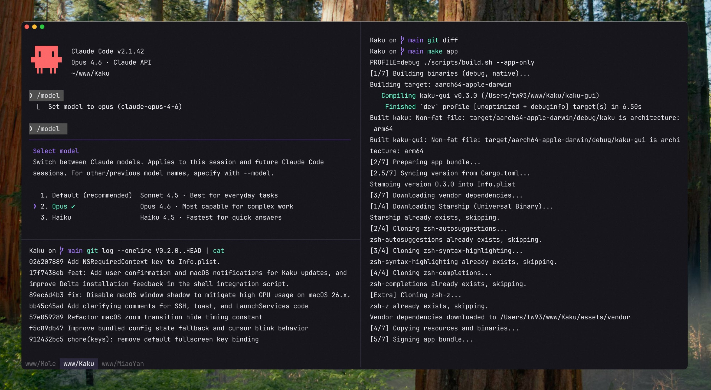

  
  <h1>Faz</h1>
  
<em>A fast, out-of-the-box Mac terminal.</em>

  
  
  
  
  

  

## Why

Faz (書く, かく) is the Japanese word for writing: the act of putting thought into form. A deeply customized fork of WezTerm, built for practical defaults on day one while keeping full Lua customization and a fast, lightweight feel.

Part of a trilogy: [Faz](https://github.com/tw93/Faz) (書く) writes code, [Waza](https://github.com/tw93/Waza) (技) drills habits, [Kami](https://github.com/tw93/Kami) (紙) ships documents. Think of them as a family: Faz is the dad, Waza the big sister, Kami the little sister.

## Features

- **Zero Config**: Defaults with JetBrains Mono, macOS font rendering, and low-res font sizing.
- **Theme-Aware Experience**: Auto-switches between dark and light modes with macOS, with tuned selection colors, font weight, and practical color overrides support.
- **Curated Shell Suite**: Built-in zsh plugins with optional CLI tools for prompt, diff, and navigation workflows.
- **Fast & Lightweight**: 40% smaller binary, instant startup, lazy loading, stripped-down GPU-accelerated core.
- **WezTerm-Compatible Config**: Use WezTerm's Lua config directly with full API compatibility and no migration.
- **Polished Defaults**: Copy on select, clickable file paths, history peek from full-screen apps, pane input broadcast, and visual bell on background tab completion.

## Quick Start

1. [Download Faz DMG](https://github.com/tw93/Faz/releases/latest) & Drag to Applications
2. Open Faz. The app is notarized by Apple, so it opens without security warnings
3. On first launch, Faz will automatically set up your shell environment

## Usage Guide

| Action | Shortcut |
| :--- | :--- |
| New Tab | `Cmd + T` |
| New Window | `Cmd + N` |
| Close Tab/Pane | `Cmd + W` |
| Navigate Tabs | `Cmd + Shift + [` / `]` or `Cmd + 1–9` |
| Navigate Panes | `Cmd + Opt + Arrows` |
| Split Pane Vertical | `Cmd + D` |
| Split Pane Horizontal | `Cmd + Shift + D` |
| Open Settings Panel | `Cmd + ,` |
| Open Lazygit | `Cmd + Shift + G` |
| Yazi File Manager | `Cmd + Shift + Y` or `y` |
| Clear Screen | `Cmd + K` |

Full keybinding reference: [docs/keybindings.md](docs/keybindings.md)

## Performance

| Metric | Upstream | Faz | Methodology |
| :--- | :--- | :--- | :--- |
| **Executable Size** | ~67 MB | ~40 MB | Aggressive symbol stripping & feature pruning |
| **Resources Volume** | ~100 MB | ~80 MB | Asset optimization & lazy-loaded assets |
| **Launch Latency** | Standard | Instant | Just-in-time initialization |
| **Shell Bootstrap** | ~200ms | ~100ms | Optimized environment provisioning |

## FAQ

**Is there a Windows or Linux version?** Not currently. Faz is macOS-only for now.

**Can I use transparent windows?** Yes, set `config.window_background_opacity` in `~/.config/faz/faz.lua`.

**The `faz` command is missing.** Run `/Applications/Faz.app/Contents/MacOS/faz init --update-only && exec zsh -l`, then `faz doctor`.

Full FAQ: [docs/faq.md](docs/faq.md)

## Docs

- [Keybindings](docs/keybindings.md) - full shortcut reference
- [Features](docs/features.md) - lazygit, yazi, shell suite
- [Configuration](docs/configuration.md) - themes, fonts, custom keybindings, Lua API
- [CLI Reference](docs/cli.md) - `faz config`, `faz doctor`, and more
- [FAQ](docs/faq.md) - common questions and troubleshooting

## Background

I heavily rely on the CLI for both work and personal projects. Tools I've built, like [Mole](https://github.com/tw93/mole) and [Pake](https://github.com/tw93/pake), reflect this.

I used Alacritty for years and learned to value speed and simplicity. As my workflow shifted toward AI-assisted coding, I wanted stronger tab and pane ergonomics. I also explored Kitty, Ghostty, Warp, and iTerm2. Each is strong in different areas, but I still wanted a setup that matched my own balance of performance, defaults, and control.

WezTerm is robust and highly hackable, and I am grateful for its engine and ecosystem. So I built Faz to be that environment: fast, polished, and ready to work.

## Contributors

Big thanks to all contributors who helped build Faz. Go follow them! ❤️

## Support

- The most direct way to support me is getting [Mole for Mac](https://mole.fit), my paid Mac cleanup app.
- If Faz helped you, give it a star, [share it](https://twitter.com/intent/tweet?url=https://github.com/tw93/Faz&text=Faz%20-%20A%20fast%20terminal%20built%20for%20AI%20coding.), or open an issue or PR.
- I have two cats, TangYuan and Coke. If you think Faz delights your life, you can feed them <a href="https://cats.tw93.fun?name=Faz" target="_blank">canned food 🥩</a>.

These lovely people already did 🐱

 

## License

MIT License, feel free to enjoy and participate in open source.
